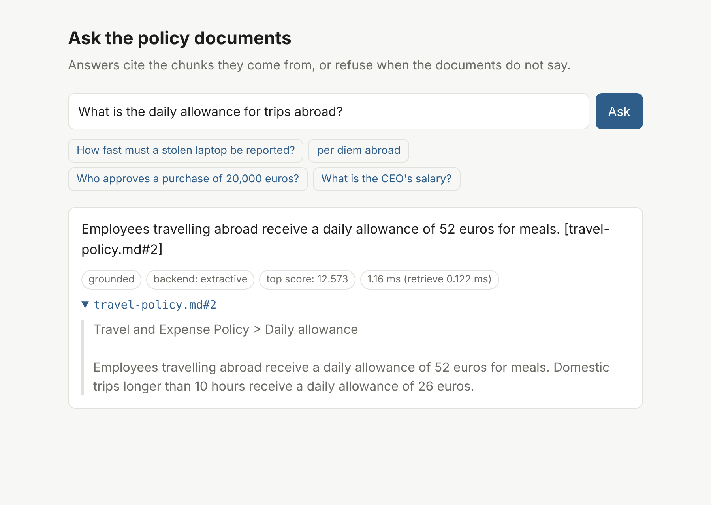
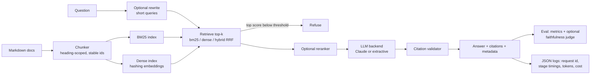

# docs-rag-evals

[](https://github.com/ChauHuynh17071994/docs-rag-evals/actions/workflows/ci.yml)


**Question answering over company documents that cites its sources, refuses when it doesn't know, and is measured by an evaluation suite that runs on every commit.**

Most RAG demos stop at "it answered my question". This project treats a RAG system the way you would treat any production component: every answer must be traceable to a source chunk, unsupported questions must be refused, and retrieval and answer quality are tracked with numbers in CI so regressions are caught before they ship.

## Features

- **Cited answers.** The model may only cite chunk ids it was given (`[travel-policy.md#2]`). Citations are parsed and validated; anything pointing outside the retrieved context is flagged as `invalid_citations`.
- **Refusals.** If retrieval evidence is weak, the pipeline answers *"I don't know based on the available documents."* without spending an LLM call.
- **Query rewriting and reranking.** Short keyword queries are expanded from a glossary (or by Claude) before retrieval, and a second-stage reranker reorders a candidate pool. Both are flags, both are measured.
- **Pluggable backends.** `claude` (Anthropic API) for real answers, `extractive` (offline, deterministic) for tests and CI.
- **Dependency-free retrieval.** Markdown-aware chunking, an Okapi BM25 implementation written from scratch, an offline character n-gram hashing embedder, and hybrid search with reciprocal rank fusion (`--retriever bm25|dense|hybrid`).
- **Evaluation suite.** 33 questions, including short keyword queries and unanswerable hard negatives, scored on six metrics with a quality gate in CI.
- **Faithfulness judge.** `--judge lexical` (offline) or `--judge claude` (LLM-as-judge) checks every answer sentence against the chunks it cites.
- **Production touches.** Docker image with a prebuilt index, JSON request logs with request ids, per-stage timings and token/cost tracking on every answer.
- **API, CLI and web UI.** FastAPI service (`/ask`, `/health`, `/chunks/{id}`), a single-page UI at `/`, and a `rag` command line tool.



## Architecture



## Evaluation

Run with `python -m rag.cli eval`. Metrics:

| Metric | What it measures |
|---|---|
| recall@k | gold chunk is in the retrieved set |
| MRR | how high the gold chunk ranks |
| answer_match | answer contains the expected key facts |
| citation_valid | answered questions cite only retrieved chunks (1.000 in every config below) |
| cites_gold | answered questions cite the correct chunk |
| refusal_acc | refuses unanswerable questions, answers answerable ones |
| faithfulness | (with `--judge`) share of answer sentences supported by the chunks they cite |

### Retrieval configuration comparison

Measured with `python -m evals.compare -k 4` and `-k 1`: offline `extractive` backend, 33 questions (21 full questions, 8 short keyword queries such as "pw length" or "per diem abroad", 4 unanswerable). Latency is in-process pipeline time on a small cloud container, without an LLM call.

k = 4:

| config | recall@k | mrr | answer_match | cites_gold | refusal_acc | avg_latency_ms |
|---|---|---|---|---|---|---|
| bm25 | 0.897 | 0.856 | 0.690 | 0.920 | 0.818 | 0.09 |
| bm25 + rerank | 0.897 | 0.874 | 0.690 | 0.960 | 0.818 | 0.17 |
| bm25 + rewrite | 0.931 | 0.914 | 0.793 | 0.963 | 0.879 | 0.10 |
| bm25 + rerank + rewrite | 0.931 | 0.931 | 0.793 | 1.000 | 0.879 | 0.17 |
| dense | 0.966 | 0.925 | 0.759 | 0.963 | 0.879 | 2.03 |
| dense + rerank | 0.966 | 0.943 | 0.759 | 0.963 | 0.879 | 2.01 |
| dense + rewrite | 1.000 | 0.983 | 0.828 | 1.000 | 0.909 | 1.79 |
| dense + rerank + rewrite | 1.000 | 1.000 | 0.828 | 1.000 | 0.909 | 2.06 |
| hybrid | 0.966 | 0.925 | 0.759 | 0.963 | 0.879 | 1.85 |
| hybrid + rerank | 0.966 | 0.943 | 0.759 | 0.963 | 0.879 | 2.02 |
| hybrid + rewrite | 1.000 | 0.983 | 0.828 | 1.000 | 0.909 | 1.90 |
| hybrid + rerank + rewrite | 1.000 | 1.000 | 0.828 | 1.000 | 0.909 | 2.08 |

k = 1 (only the top chunk reaches the generator, so ranking quality matters most):

| config | recall@k | mrr | answer_match | cites_gold | refusal_acc | avg_latency_ms |
|---|---|---|---|---|---|---|
| bm25 | 0.828 | 0.828 | 0.690 | 0.920 | 0.818 | 0.07 |
| bm25 + rerank | 0.862 | 0.862 | 0.690 | 0.960 | 0.818 | 0.13 |
| bm25 + rewrite | 0.897 | 0.897 | 0.793 | 0.963 | 0.879 | 0.07 |
| bm25 + rerank + rewrite | 0.931 | 0.931 | 0.793 | 1.000 | 0.879 | 0.15 |
| dense | 0.897 | 0.897 | 0.724 | 0.926 | 0.879 | 1.74 |
| dense + rerank | 0.931 | 0.931 | 0.759 | 0.963 | 0.879 | 1.90 |
| dense + rewrite | 0.966 | 0.966 | 0.793 | 0.964 | 0.909 | 1.68 |
| dense + rerank + rewrite | 1.000 | 1.000 | 0.828 | 1.000 | 0.909 | 2.02 |
| hybrid | 0.897 | 0.897 | 0.724 | 0.926 | 0.879 | 1.71 |
| hybrid + rerank | 0.931 | 0.931 | 0.759 | 0.963 | 0.879 | 1.96 |
| hybrid + rewrite | 0.966 | 0.966 | 0.793 | 0.964 | 0.909 | 1.81 |
| hybrid + rerank + rewrite | 1.000 | 1.000 | 0.828 | 1.000 | 0.909 | 1.96 |

What the numbers show:

- **Dense / hybrid vs BM25.** BM25 matches exact tokens, so "minimum password length" misses "Passwords must be at least 14 characters long". Character n-gram embeddings close that gap (recall@4 0.897 → 0.966).
- **Reranking** (`--rerank`) rescores a 20-chunk pool by query-term coverage, term proximity and heading match. It mainly fixes ordering: at k = 1 it adds 3–4 points of recall in every configuration, for under 0.4 ms.
- **Query rewriting** (`--rewrite glossary`) expands queries of three terms or fewer with a small HR/IT glossary ("wfh" → "work remotely"). It gives the largest gain on short queries and cuts wrong refusals of answerable ones (refusal_acc 0.818 → 0.879 with BM25), because the expanded query carries enough evidence to pass the threshold.
- **Best offline config:** `--retriever hybrid --rerank --rewrite glossary` reaches recall@1 = 1.000 and cites_gold = 1.000 on this set.

Caveats: the eval set is small, and the glossary, the dense refusal threshold (`--min-similarity 0.22`) and the short queries were written by the same person, so these are indicative results, not held-out ones. The remaining refusal errors (u02, u04) come from BM25 matching the company name in the corpus intro.

### Faithfulness judge

`python -m rag.cli eval --judge lexical` scores every non-refused answer against the chunks it cites. With the offline `extractive` backend faithfulness is 1.000 on all 33 questions, as expected: that backend copies a sentence from a retrieved chunk, so it cannot add facts. The metric is meant for generative backends. A unit test with a backend that appends an unsupported sentence confirms the judge catches it, and `--judge claude` uses Claude as the judge for paraphrased answers the lexical check cannot assess. I have not yet published Claude-backend numbers here, because they need an API key that CI does not have.

CI fails if recall@k, MRR, citation validity or refusal accuracy drop below their thresholds (`evals/run_eval.py`). Every run posts the per-question report (`--markdown`) and the configuration comparison table to the GitHub Actions job summary and uploads them as the `eval-report` artifact.

## Quickstart

```bash
git clone https://github.com/ChauHuynh17071994/docs-rag-evals.git
cd docs-rag-evals
pip install -e ".[dev]"

# Offline, no API key needed
python -m rag.cli ask "What is the daily allowance for trips abroad?"
# -> Employees travelling abroad receive a daily allowance of 52 euros for meals. [travel-policy.md#2]

# With Claude
cp .env.example .env   # add ANTHROPIC_API_KEY
RAG_BACKEND=claude python -m rag.cli ask "Can drivers work remotely?"

# Hybrid retrieval (BM25 + embeddings, reciprocal rank fusion)
python -m rag.cli --retriever hybrid ask "What is the minimum password length?"

# Evaluate
python -m rag.cli eval
python -m evals.compare                     # retriever x reranker table
python -m rag.cli --retriever hybrid --rerank --rewrite glossary eval
RAG_BACKEND=claude python -m rag.cli eval   # compare backends

python -m rag.cli eval --judge lexical      # + faithfulness metric

# API + web UI (open http://localhost:8000)
uvicorn rag.api:app --reload
curl -X POST localhost:8000/ask -H "Content-Type: application/json" \
     -d '{"question": "Who approves a purchase of 20,000 euros?"}'

# Docker (index is built into the image; .env is optional)
docker compose up --build
```

## Running in production

- **Image.** `Dockerfile` installs dependencies in a cached layer, builds `index.json` at build time (`RAG_INDEX`), runs as a non-root user and has a health check on `/health`. The image is 248 MB (`python:3.12-slim` base). CI builds it and smoke-tests `/ask` in the container on every push.
- **Configuration.** Same variables as the CLI flags: `RAG_BACKEND`, `RAG_RETRIEVER`, `RAG_RERANK`, `RAG_REWRITE`, `RAG_LOG_LEVEL` (see `.env.example`).
- **Logs.** One JSON line per request (`method`, `path`, `status`, `duration_ms`) and per answer (`refused`, `grounded`, citation counts, stage timings, tokens, cost), all tagged with a `request_id`. Send `X-Request-ID` to reuse your own id; it is echoed in the response header and body.
- **Cost.** The Claude backend reads token counts from the API response and prices them from a table in `rag/llm.py` (override with `RAG_PRICE_IN` / `RAG_PRICE_OUT`, USD per million tokens). The offline backend reports zero tokens.

Example `/ask` response fields: `timings: {"rewrite_ms": 0.002, "retrieve_ms": 0.12, "generate_ms": 0.05}`, `usage: {"input_tokens": 0, "output_tokens": 0, "cost_usd": 0.0}`.

## Project layout

```
rag/
  chunking.py   heading-scoped Markdown chunking
  bm25.py       Okapi BM25 retriever
  embeddings.py hashing embedder, dense index, optional sentence-transformers
  index.py      bm25 / dense / hybrid (RRF) search + JSON persistence
  rerank.py     second-stage lexical reranker
  rewrite.py    glossary / Claude query rewriting for short queries
  llm.py        LLM protocol, Claude and extractive backends, prompt
  pipeline.py   retrieve -> refuse -> generate -> validate citations
  api.py        FastAPI service, request logging, UI route
  observability.py JSON logging with request ids
  static/       single-page web UI
  cli.py        ingest / ask / eval
evals/
  dataset.jsonl 33 questions incl. short and unanswerable ones
  run_eval.py   metrics, report, CI gate
  compare.py    retriever comparison table
  judge.py      faithfulness judges (lexical, Claude)
  report.py     per-question Markdown report
data/docs/      sample policy documents (fictional company)
tests/          unit and API tests
```

## Design notes

- **Why validate citations?** A citation the model invented looks exactly as trustworthy as a real one to a reader. Checking every cited id against the retrieved set turns "looks grounded" into "is grounded".
- **Why refuse before calling the LLM?** It is cheaper, faster, and removes the most common hallucination path: asking a model to answer from irrelevant context.
- **Why an offline backend?** CI should be deterministic and free. The extractive backend gives a reproducible baseline; the Claude backend is evaluated on demand with the same suite.

## License

MIT
