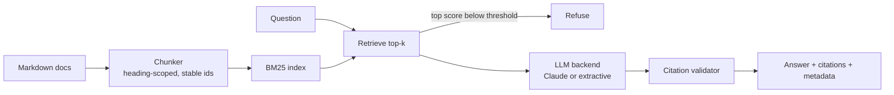

# docs-rag-evals

[](https://github.com/ChauHuynh17071994/docs-rag-evals/actions/workflows/ci.yml)


**Question answering over company documents that cites its sources, refuses when it doesn't know, and is measured by an evaluation suite that runs on every commit.**

Most RAG demos stop at "it answered my question". This project treats a RAG system the way you would treat any production component: every answer must be traceable to a source chunk, unsupported questions must be refused, and retrieval and answer quality are tracked with numbers in CI so regressions are caught before they ship.

## Features

- **Cited answers.** The model may only cite chunk ids it was given (`[travel-policy.md#2]`). Citations are parsed and validated; anything pointing outside the retrieved context is flagged as `invalid_citations`.
- **Refusals.** If retrieval evidence is weak, the pipeline answers *"I don't know based on the available documents."* without spending an LLM call.
- **Pluggable backends.** `claude` (Anthropic API) for real answers, `extractive` (offline, deterministic) for tests and CI.
- **Dependency-free retrieval.** Markdown-aware chunking and an Okapi BM25 implementation written from scratch.
- **Evaluation suite.** 25 questions, including unanswerable hard negatives, scored on six metrics with a quality gate in CI.
- **API + CLI.** FastAPI service (`/ask`, `/health`) and a `rag` command line tool.

## Architecture



## Evaluation

Run with `python -m rag.cli eval`. Current results with the offline `extractive` backend (k = 4):

| Metric | Score | What it measures |
|---|---|---|
| recall@k | 0.952 | gold chunk is in the retrieved set |
| MRR | 0.929 | how high the gold chunk ranks |
| answer_match | 0.762 | answer contains the expected key facts |
| citation_valid | 1.000 | answered questions cite only retrieved chunks |
| cites_gold | 0.950 | answered questions cite the correct chunk |
| refusal_acc | 0.880 | refuses unanswerable questions, answers answerable ones |

CI fails if recall@k, MRR, citation validity or refusal accuracy drop below their thresholds (`evals/run_eval.py`). Known weak spot: q11 ("minimum password length") misses because the document says "at least 14 characters long", a vocabulary gap that lexical retrieval cannot bridge. Hybrid retrieval is on the [roadmap](ROADMAP.md).

## Quickstart

```bash
git clone https://github.com/ChauHuynh17071994/docs-rag-evals.git
cd docs-rag-evals
pip install -e ".[dev]"

# Offline, no API key needed
python -m rag.cli ask "What is the daily allowance for trips abroad?"
# -> Employees travelling abroad receive a daily allowance of 52 euros for meals. [travel-policy.md#2]

# With Claude
cp .env.example .env   # add ANTHROPIC_API_KEY
RAG_BACKEND=claude python -m rag.cli ask "Can drivers work remotely?"

# Evaluate
python -m rag.cli eval
RAG_BACKEND=claude python -m rag.cli eval   # compare backends

# API
uvicorn rag.api:app --reload
curl -X POST localhost:8000/ask -H "Content-Type: application/json" \
     -d '{"question": "Who approves a purchase of 20,000 euros?"}'
```

## Project layout

```
rag/
  chunking.py   heading-scoped Markdown chunking
  bm25.py       Okapi BM25 retriever
  index.py      index build + JSON persistence
  llm.py        LLM protocol, Claude and extractive backends, prompt
  pipeline.py   retrieve -> refuse -> generate -> validate citations
  api.py        FastAPI service
  cli.py        ingest / ask / eval
evals/
  dataset.jsonl 25 questions incl. unanswerable ones
  run_eval.py   metrics, report, CI gate
data/docs/      sample policy documents (fictional company)
tests/          unit and API tests
```

## Design notes

- **Why validate citations?** A citation the model invented looks exactly as trustworthy as a real one to a reader. Checking every cited id against the retrieved set turns "looks grounded" into "is grounded".
- **Why refuse before calling the LLM?** It is cheaper, faster, and removes the most common hallucination path: asking a model to answer from irrelevant context.
- **Why an offline backend?** CI should be deterministic and free. The extractive backend gives a reproducible baseline; the Claude backend is evaluated on demand with the same suite.

## License

MIT
