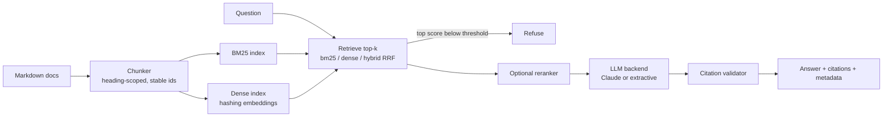

# docs-rag-evals

[](https://github.com/ChauHuynh17071994/docs-rag-evals/actions/workflows/ci.yml)


**Question answering over company documents that cites its sources, refuses when it doesn't know, and is measured by an evaluation suite that runs on every commit.**

Most RAG demos stop at "it answered my question". This project treats a RAG system the way you would treat any production component: every answer must be traceable to a source chunk, unsupported questions must be refused, and retrieval and answer quality are tracked with numbers in CI so regressions are caught before they ship.

## Features

- **Cited answers.** The model may only cite chunk ids it was given (`[travel-policy.md#2]`). Citations are parsed and validated; anything pointing outside the retrieved context is flagged as `invalid_citations`.
- **Refusals.** If retrieval evidence is weak, the pipeline answers *"I don't know based on the available documents."* without spending an LLM call.
- **Pluggable backends.** `claude` (Anthropic API) for real answers, `extractive` (offline, deterministic) for tests and CI.
- **Dependency-free retrieval.** Markdown-aware chunking, an Okapi BM25 implementation written from scratch, an offline character n-gram hashing embedder, and hybrid search with reciprocal rank fusion (`--retriever bm25|dense|hybrid`).
- **Evaluation suite.** 25 questions, including unanswerable hard negatives, scored on six metrics with a quality gate in CI.
- **API + CLI.** FastAPI service (`/ask`, `/health`) and a `rag` command line tool.

## Architecture



## Evaluation

Run with `python -m rag.cli eval`. Metrics:

| Metric | What it measures |
|---|---|
| recall@k | gold chunk is in the retrieved set |
| MRR | how high the gold chunk ranks |
| answer_match | answer contains the expected key facts |
| citation_valid | answered questions cite only retrieved chunks (1.000 in every config below) |
| cites_gold | answered questions cite the correct chunk |
| refusal_acc | refuses unanswerable questions, answers answerable ones |

### Retriever and reranker comparison

Measured with `python -m evals.compare -k 4` and `-k 1` (offline `extractive` backend, 25 questions; latency is the in-process pipeline time on a small cloud container, no LLM call).

k = 4:

| config | recall@k | mrr | answer_match | cites_gold | refusal_acc | avg_latency_ms |
|---|---|---|---|---|---|---|
| bm25 | 0.952 | 0.929 | 0.810 | 0.950 | 0.880 | 0.11 |
| bm25 + rerank | 0.952 | 0.952 | 0.810 | 1.000 | 0.880 | 0.17 |
| dense | 1.000 | 1.000 | 0.857 | 1.000 | 0.920 | 2.04 |
| dense + rerank | 1.000 | 1.000 | 0.857 | 1.000 | 0.920 | 2.29 |
| hybrid | 1.000 | 1.000 | 0.857 | 1.000 | 0.920 | 2.91 |
| hybrid + rerank | 1.000 | 1.000 | 0.857 | 1.000 | 0.920 | 3.61 |

k = 1 (only the top chunk reaches the generator, so ranking quality matters most):

| config | recall@k | mrr | answer_match | cites_gold | refusal_acc | avg_latency_ms |
|---|---|---|---|---|---|---|
| bm25 | 0.905 | 0.905 | 0.810 | 0.950 | 0.880 | 0.09 |
| bm25 + rerank | 0.952 | 0.952 | 0.810 | 1.000 | 0.880 | 0.15 |
| dense | 1.000 | 1.000 | 0.857 | 1.000 | 0.920 | 1.78 |
| dense + rerank | 1.000 | 1.000 | 0.857 | 1.000 | 0.920 | 2.07 |
| hybrid | 1.000 | 1.000 | 0.857 | 1.000 | 0.920 | 1.81 |
| hybrid + rerank | 1.000 | 1.000 | 0.857 | 1.000 | 0.920 | 1.96 |

The BM25 miss is q11 ("minimum password length"): the document says "Passwords must be at least 14 characters long", and exact-token BM25 does not match "password" to "passwords". Character n-gram embeddings close that gap. The dense refusal threshold (`--min-similarity 0.22`) was calibrated on this same small set, so treat these numbers as indicative, not as a held-out result. The two remaining refusal errors (u02, u04) come from BM25 matching the company name in the corpus intro.

The lexical reranker (`--rerank`) rescoring a 20-chunk pool by query-term coverage, term proximity and heading match lifts BM25 at k = 1 (recall 0.905 → 0.952, cites_gold 0.950 → 1.000) for under 0.1 ms. Dense and hybrid retrieval already rank every gold chunk first on this set, so the reranker has no headroom there; a harder eval set is needed to separate them.

CI fails if recall@k, MRR, citation validity or refusal accuracy drop below their thresholds (`evals/run_eval.py`).

## Quickstart

```bash
git clone https://github.com/ChauHuynh17071994/docs-rag-evals.git
cd docs-rag-evals
pip install -e ".[dev]"

# Offline, no API key needed
python -m rag.cli ask "What is the daily allowance for trips abroad?"
# -> Employees travelling abroad receive a daily allowance of 52 euros for meals. [travel-policy.md#2]

# With Claude
cp .env.example .env   # add ANTHROPIC_API_KEY
RAG_BACKEND=claude python -m rag.cli ask "Can drivers work remotely?"

# Hybrid retrieval (BM25 + embeddings, reciprocal rank fusion)
python -m rag.cli --retriever hybrid ask "What is the minimum password length?"

# Evaluate
python -m rag.cli eval
python -m evals.compare                     # retriever x reranker table
python -m rag.cli --retriever hybrid --rerank eval
RAG_BACKEND=claude python -m rag.cli eval   # compare backends

# API
uvicorn rag.api:app --reload
curl -X POST localhost:8000/ask -H "Content-Type: application/json" \
     -d '{"question": "Who approves a purchase of 20,000 euros?"}'
```

## Project layout

```
rag/
  chunking.py   heading-scoped Markdown chunking
  bm25.py       Okapi BM25 retriever
  embeddings.py hashing embedder, dense index, optional sentence-transformers
  index.py      bm25 / dense / hybrid (RRF) search + JSON persistence
  rerank.py     second-stage lexical reranker
  llm.py        LLM protocol, Claude and extractive backends, prompt
  pipeline.py   retrieve -> refuse -> generate -> validate citations
  api.py        FastAPI service
  cli.py        ingest / ask / eval
evals/
  dataset.jsonl 25 questions incl. unanswerable ones
  run_eval.py   metrics, report, CI gate
  compare.py    retriever comparison table
data/docs/      sample policy documents (fictional company)
tests/          unit and API tests
```

## Design notes

- **Why validate citations?** A citation the model invented looks exactly as trustworthy as a real one to a reader. Checking every cited id against the retrieved set turns "looks grounded" into "is grounded".
- **Why refuse before calling the LLM?** It is cheaper, faster, and removes the most common hallucination path: asking a model to answer from irrelevant context.
- **Why an offline backend?** CI should be deterministic and free. The extractive backend gives a reproducible baseline; the Claude backend is evaluated on demand with the same suite.

## License

MIT
